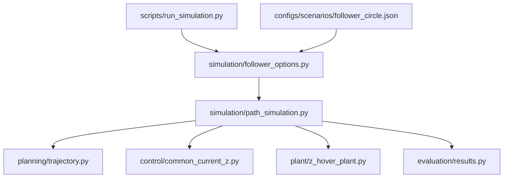

# Luồng chạy theo file

## Một chương trình chính

`python scripts/run_simulation.py --scenario configs/scenarios/follower_circle.json`

`run_simulation.py` chỉ import và gọi `main()`. `main()` đọc options rồi tạo `FollowerSimulation` và gọi `run()`. Vòng lặp không nằm trong script.

## Trình tự một bước vật lý

Trong `FollowerSimulation.step(k)`:

1. Nếu tới control tick, gọi `simulation/safety.py` kiểm tra khoảng hở robot/bàn/bể.
2. Nếu chạy follow, lấy mục tiêu từ `planning/trajectory.py`; gửi cho `simulation/aubo_cartesian_controller.py` rồi `aubo_ik.py`.
3. Tại control tick, gọi `control/common_current_z.py`: lấy localization, tính PID+FF, phân bổ dòng chung và chống tích lũy khi bão hòa. Chế độ open-loop chỉ lấy phép đo và giữ dòng cố định.
4. Gọi `plant/z_hover_plant.py::step(currents)`: nguồn dòng → lực/mô-men từ → lực chất lỏng → bước MuJoCo.
5. Tích lũy thống kê nhiễu; tới chu kỳ ghi thì `evaluation/results.py` ghi mẫu. Kiểm tra capsule có rời ROI chẩn đoán không.
6. Viewer hiển thị trạng thái. Sau khi kết thúc, lưu CSV/JSON/PNG và in kết quả.

Baseline: physics dt 1 ms, control dt 10 ms. Đúng thứ tự lấy mẫu trước/sau bước như file follower gốc. Controller nhận phép đo; trạng thái thật chỉ để tính vật lý, giám sát và đánh giá.

## Muốn sửa gì thì mở file nào

Các đường dẫn sau nằm dưới `src/endoscopy_capsule_control/`, trừ `configs` và `scripts`.

| Muốn thay đổi | File |
|---|---|
| Bán kính vòng, thời gian, seed, noise, camera | `configs/scenarios/follower_circle.json` hoặc cờ CLI |
| Thêm tham số dòng lệnh, kiểm tra input | `simulation/follower_options.py` |
| Cách tạo đường thẳng/vòng tròn | `planning/trajectory.py` |
| Chu kỳ gọi module, điều kiện chạy/dừng | `simulation/path_simulation.py` |
| Luật dòng chung PID+FF giữ Z | `control/common_current_z.py` |
| Công thức PID cơ sở | `control/pid_z.py` |
| Gains, thông số vật lý mặc định | `config.py` |
| Servo robot XY | `simulation/aubo_cartesian_controller.py`, `simulation/aubo_ik.py` |
| Plant vật lý | `plant/z_hover_plant.py` |
| Đáp ứng nguồn dòng và nhiễu dòng | `plant/power_supply.py` |
| Sai số và trễ định vị | `plant/localization.py` |
| Sai số pose robot | `plant/robot_uncertainty.py` |
| Công thức từ trường/lực/mô-men | `magnetic/` |
| Dựng robot, DEMA, bể, bàn | `models/aubo_i10.xml` |
| Khoảng hở robot với bàn/bể | `simulation/safety.py` |
| Camera | `simulation/viewer.py` |
| Cột CSV, metadata, đồ thị, chỉ số | `evaluation/results.py` |
| Quét nhiều seed/tham số | `scripts/run_follower_sweep.py` |
| Static force scan | `simulation/follower_scan.py`, chạy với `--mode scan` |

## Cấu hình và đơn vị

- `config.py` giữ thông số plant/controller.
- JSON scenario chọn thí nghiệm. Tên key là tên argparse dùng dấu gạch dưới: `move_time`, `x0_mm`, `noise`...
- Cờ CLI được ưu tiên hơn JSON. Không có `--scenario` thì giữ nguyên default của follower gốc (hold, x0=1 mm, noise none, plot tắt, viewer bật).
- Cờ có hậu tố `mm`, `ms`, `deg` được đổi đơn vị tại biên; mô hình vật lý dùng m, s, rad, A.
- CSV giữ nguyên 30 cột để sweep và công cụ cũ đọc được. `x_lcs_m/y_lcs_m/z_lcs_m` thuộc frame DEMA đang di chuyển; đồ thị commanded-path chuyển về frame DEMA ban đầu cố định trong world.
- JSON ghi fingerprint toàn bộ mã Python trong package để một hash script ngắn không che mất thay đổi controller.

## Các file trông giống nhau nhưng KHÔNG cùng controller

`control/common_current_z.py` là controller của luồng mới. `control/z_hover_controller.py` và `control/vertical_allocator.py` phục vụ nhánh hover khác; `xyz_pid_ff.py`, `robot_current_allocator.py` thuộc nhánh thử nghiệm XYZ. Giữ nguyên chúng vì package và tests còn tham chiếu. Không đổi tên/gộp controller chỉ theo tên gần giống.

## Path planning đã ghép

Dùng cùng `scripts/run_simulation.py` với `configs/scenarios/one_column.json`.
`planning/environment.py` chuẩn bị map, `astar.py` tìm đường với `collision.py`,
`trajectory.py` tạo reference, `simulation/scene_builder.py` dựng cột.
Vòng điều khiển vẫn ở `path_simulation.py`. Chi tiết tại `docs/PATH_PLANNING.md`.

## Tường chữ nhật

Map tường phẳng: `configs/scenarios/map.json`. Tham số `walls_cx_cy_width_height_mm` chứa `[cx, cy, size_x, size_y]`. `collision.py` kiểm tra khoảng cách đoạn/chữ nhật; `scene_builder.py` dựng box thật; `astar.py` và monitor dùng chung clearance; `results.py` vẽ vùng mở rộng. Xem `FLAT_WALLS.md`.
