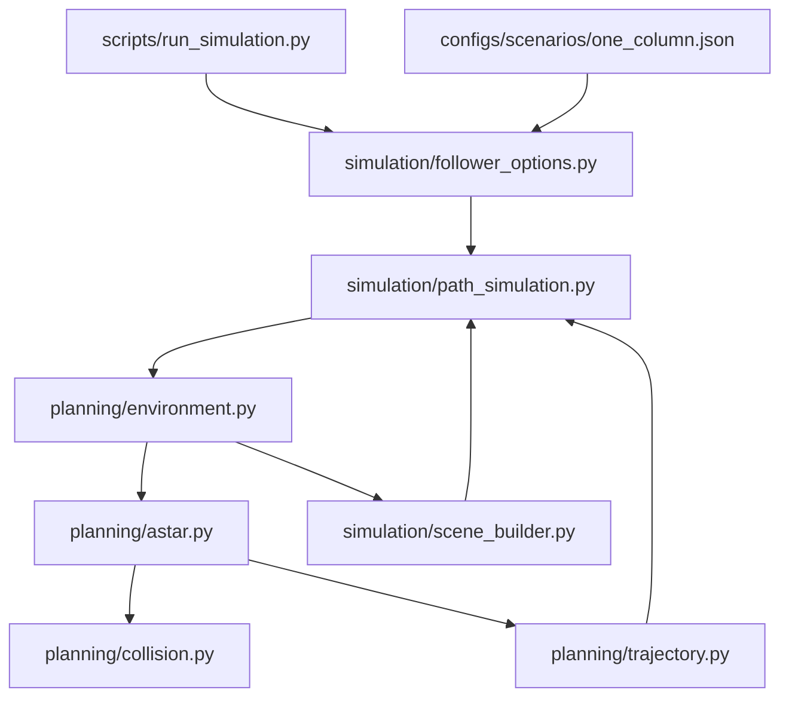

# A* trong luồng mô phỏng đã tổ chức lại

## Chạy

Tại gốc project sau khi giải nén và chạy `python -m pip install -e .`:

```powershell
python scripts/run_simulation.py --scenario configs/scenarios/one_column.json --noise none
python scripts/run_simulation.py --scenario configs/scenarios/one_column.json --noise all --seed 42 --current-tau-ms 10 --localization-delay-ms 10 --csv results/astar_noise/trajectory.csv
```

Viewer bật mặc định, preset bật PNG. Đóng viewer sau khi kết quả đã lưu để thoát. Dùng `--headless` nếu không muốn mở viewer. Thời gian chạy path tự tính từ chiều dài, giới hạn tốc độ/gia tốc, warmup và hold; `--time`/`--move-time` chỉ dùng cho chế độ follower cũ, không đặt thời gian cho path.

```powershell
python scripts/run_simulation.py --scenario configs/scenarios/one_column.json --target-mm 50 20 --speed-mm-s 2 --csv results/astar_other/trajectory.csv
```

Tau/delay mặc định trong preset bằng 0; giá trị 10 ms là giả định độ nhạy, chưa hiệu chỉnh theo phần cứng. `--noise none` không tự tắt tau/delay. Chỉ planning XY, PID+FF giữ Z bằng dòng. Không có PID XY/góc capsule.

## File nào gọi file nào



Từ `planning`/`simulation` trở đi, đường dẫn nằm trong `src/endoscopy_capsule_control/`.

| File | Nhiệm vụ |
|---|---|
| `follower_options.py` | Đọc JSON, CLI; mode mới là `path` |
| `planning/environment.py` | Đọc bản đồ, giao biên cho phép với bể, kiểm tra cấu hình, tạo plan/scene |
| `planning/astar.py` | A* 8 hướng với connector cho điểm đầu/đích chính xác; rút gọn đường |
| `planning/collision.py` | Kiểm tra toàn bộ đoạn với hình tròn mở rộng bằng phép chiếu giải tích |
| `planning/trajectory.py` | Line/circle cũ và quintic từng đoạn của path mới |
| `simulation/scene_builder.py` | Dựng cột thật, đường xanh, vòng cấm cam từ cùng bản đồ; không sửa XML gốc |
| `simulation/path_simulation.py` | Lấy reference từ plan rồi dùng servo robot và controller Z hiện có |
| `simulation/safety.py` | Giữ guard robot cũ; thêm giám sát envelope capsule/obstacle từng physics tick |
| `evaluation/results.py` | Giữ schema 30 cột CSV; thêm bản đồ, đường A* vào đồ thị và metrics path vào JSON |

`control/common_current_z.py`, plant, magnetic, gains, robot IK/servo và Simulink không thay đổi trong bản cập nhật này. `scripts/run_simulation.py` vẫn là điểm chạy duy nhất. Mọi chế độ dùng chung package trong thư mục `src`.

## Sửa môi trường

Mở `configs/scenarios/one_column.json`, phần `path`:

- `goal_xy_mm`: đích XY.
- `obstacles_x_y_radius_mm`: mỗi phần tử `[x, y, bán kính cột thật]`; mặc định `[[25,0,5]]`. Có thể thêm nhiều cột. Tường chữ nhật được hỗ trợ qua `walls_cx_cy_width_height_mm`; xem `FLAT_WALLS.md`.
- `margin_mm`: dự phòng 2 mm. Capsule dài 30 mm → hình cầu bao bán kính 15 mm → cột r=5 mm có vùng cấm r=22 mm.
- `grid_mm`: bước lưới 2 mm.
- `center_bounds_mm`: [xmin,xmax,ymin,ymax] cho TÂM capsule; chương trình giao với phần bể đã thu hẹp theo capsule + margin.
- `speed_mm_s`, `acceleration_mm_s2`: giới hạn của trajectory quintic, dừng ở mỗi waypoint.
- `warmup_s`, `hold_s`: chờ đầu và giữ cuối.
- `goal_tolerance_mm`, `goal_speed_mm_s`, `goal_hold_s`: điều kiện đạt đích XY.

Điểm đầu dùng `x0_mm`, `y0_mm` ở ngoài phần path. Bản tường phẳng giải IK để đặt DEMA phía trên điểm đầu trước khi chạy physics; từ chối khi IK thất bại hoặc guard báo thiếu khoảng hở. `z0_mm` phải bằng 0 trong chế độ path (không tạo trajectory đổi độ cao).

Map theo frame DEMA BAN ĐẦU, cố định trong world; không trôi theo robot. Đơn vị cấu hình mm, physics m. Cột kéo từ đáy dầu đến dưới mặt dầu 5 mm, xuyên qua độ cao mặc định. Planner dùng hình chiếu XY bảo thủ, không tìm đường qua trên/dưới cột. Cột giả định không làm thay đổi từ trường.

## Kết quả và giới hạn

CSV/JSON/PNG và scene XML nằm cạnh đường dẫn `--csv`. Scene XML dùng đường dẫn asset tuyệt đối ở máy chạy, chỉ tái sử dụng trực tiếp tại máy đó. Đường xanh lá là đường rút gọn; cam là vùng cấm; đỏ là cột; tím là đích. Đồ thị so sánh path với capsule thật, Z, góc và dòng.

JSON có `planning` và `path_metrics`. `success` yêu cầu kết thúc đủ thời gian, đạt đích XY với tốc độ thấp trong khoảng hold yêu cầu và không vi phạm margin. Z được báo cáo riêng; chưa có ngưỡng chất lượng Z bắt buộc cho success. Hoàn tất thời gian không tự đồng nghĩa success.

`min_obstacle_envelope_clearance_mm` là khoảng hở của hình cầu bao, bảo thủ so với vỏ capsule thật. Margin bị xâm phạm được ghi nhận; envelope chạm cột thì dừng, contact MuJoCo cũng được kiểm tra. Không có đường/đầu-đích trong vùng cấm thì không chạy. Robot guard gồm cả cột; khoảng cách tại cap 10.001 mm chỉ là cận dưới. Giám sát theo mẫu không chứng minh tránh va chạm liên tục và chưa chứng nhận tự va chạm robot.

Plant/tank vẫn là mô hình chưa hiệu chỉnh lab. Giữ cả kết quả dừng/thất bại khi đánh giá nhiều seed.
